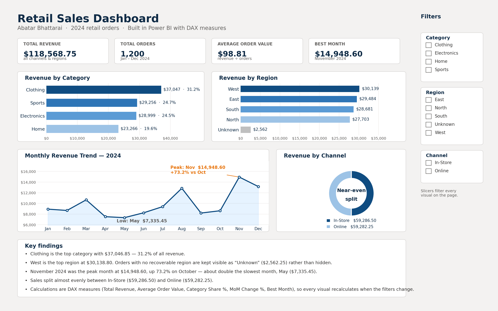

# Power BI Retail Sales Dashboard

By Abatar Bhattarai — CIS student at East Texas A&M, graduating May 2027

## Business question

Can a store's sales numbers be put in front of a manager as one interactive page — so they can filter by category, region, and channel and see the answer immediately, instead of working through static tables?

## Data

The cleaned retail dataset from my Retail Sales Analysis project: 1,200 orders from 2024 (practice data I created for that project, not real store sales).

## What I did

- Rebuilt my Python/SQL/Excel retail analysis as a one-page Power BI dashboard: KPI cards (total revenue, total orders, average order value), revenue by category, revenue by region, a monthly revenue trend for 2024, and a channel split
- Wrote all calculations as DAX measures — total revenue, total orders, average order value, category share of revenue, revenue last month, month-over-month revenue change, and best-month revenue (full set in `measures.dax`)
- Added category, region, and channel slicers that filter every visual on the page at once
- Used measures rather than calculated columns so totals recalculate correctly under any slicer selection, and `DIVIDE` instead of `/` so filtered views with no orders show blank instead of an error

## Key finding

**Total revenue: $118,568.75 from 1,200 orders** (average order value $98.81). Clothing led categories at $37,046.85 (31.2% of revenue), the West was the top region at $30,138.80, and November 2024 was the best month at $14,948.60 — up 73.2% from October. Sales split almost evenly between In-Store ($59,286.50) and Online ($59,282.25).

## Recommendation

Plan around the pattern the dashboard makes obvious: Clothing and the November peak deserve the stock and promotion focus, and since in-store and online revenue are nearly equal, neither channel should be treated as the minor one.

---

## What I found

- **Total revenue: $118,568.75** from 1,200 orders — average order value **$98.81**
- **Top category: Clothing**, $37,046.85 (31.2% of revenue), ahead of Sports (24.7%) and Electronics (24.5%)
- **Top region: West**, $30,138.80. Orders whose region could not be recovered are kept visible as "Unknown" ($2,562.25) instead of being hidden
- **Best month: November 2024**, $14,948.60 — up **73.2%** from October, and about double the slowest month (May 2024, $7,335.45)
- Sales split almost evenly between **In-Store ($59,286.50)** and **Online ($59,282.25)**

## About this project

After analysing my retail sales data with Python, SQL, and Excel, I rebuilt the summary as an interactive dashboard in Power BI so the numbers can be filtered and explored instead of sitting in a static table.

The dashboard is one page: KPI cards (total revenue, total orders, average order value), revenue by category, revenue by region, a monthly revenue trend for 2024, and a channel split. Category, region, and channel slicers filter every visual on the page at once.

All calculations are DAX measures I wrote — total revenue, total orders, average order value, category share of revenue, revenue last month, month-over-month revenue change, and best-month revenue. The full set is in `measures.dax`. I used measures rather than calculated columns for the totals so they recalculate correctly under any slicer selection, and `DIVIDE` instead of `/` so filtered views with no orders show blank instead of an error. Month-over-month uses `DATEADD` against a `MonthStart` helper column that puts every order on the first of its month.

## Files

- `retail-sales-dashboard.pbit` — the Power BI file. Open it in Power BI Desktop (free) and the dashboard builds itself from the data embedded in the file; save it as a `.pbix` if you want the regular format
- `dashboard.png` — screenshot of the finished dashboard
- `retail_orders_clean.csv` — the cleaned dataset (from my Retail Sales Analysis project)
- `measures.dax` — the DAX measures I wrote for this dashboard
- `BUILD-GUIDE.md` — how the dashboard is built, step by step

## Tools used

Power BI Desktop, DAX, Power Query. Dataset from my Retail Sales Analysis project (Python / SQL / Excel).

The data is practice data I made for my Retail Sales Analysis project, not real store sales.
